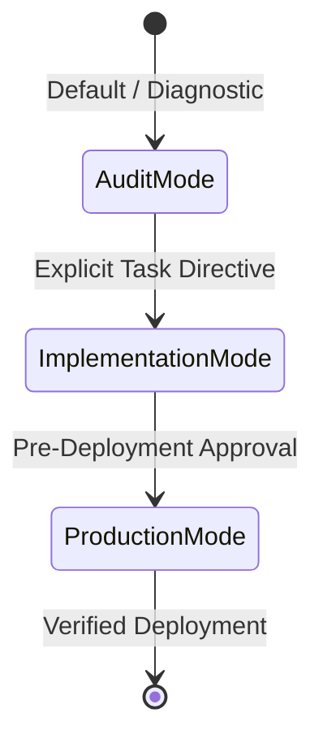
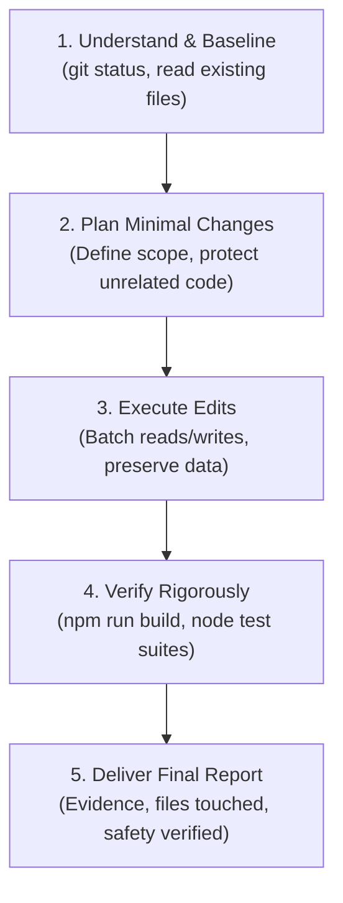

# NEXWORLD TRAVEL — MASTER AI ENGINEERING INSTRUCTIONS (AGENTS.md)

> **Audience**: All future AI coding agents, autonomous subagents, and software engineers working on the **NexWorld Travel & Tourism** codebase.  
> **Authority**: Principal Software Architect & Lead Systems Engineer.  
> **Status**: Mandatory & Active.

---

## 1. Prime Directive: Protect Production & Existing Client Data

The NexWorld Travel platform ([nexworldtravel.com](https://nexworldtravel.com)) is an enterprise luxury travel and membership lifecycle platform actively deployed in production on Railway, backed by MongoDB Atlas. It serves live high-net-worth members, travel consultants, and administrative executives.

**The client, staff, and members actively add, edit, and query records through the live platform.**

Preserving existing client records, uploaded assets, financial histories, and working functionality is strictly prioritized above any automated refactoring, optimization, or bug fix.

### Absolute Invariants:
1. **Zero Destructive Database Operations**: Never execute `db.dropDatabase()`, `collection.drop()`, seed replacement scripts, or destructive schema migrations against a database containing production records.
2. **Zero Unapproved Data Mutation**: Never delete, overwrite, reset, or alter member accounts, booking histories, EMI records, payment transactions, employee permissions, holiday packages, destinations, or activities.
3. **Zero Secret Exposure**: Never commit, log, or output credentials, API secrets, JWT secrets, SMTP credentials, or MongoDB connection strings with cleartext passwords.
4. **Zero Silent Breaking Changes**: Never alter existing API route contracts, database field types, or frontend component contracts without strict backward compatibility.
5. **Zero Auto-Deployment**: Never automatically commit, push to Git remotes, or trigger deployment pipelines unless explicitly commanded by the user.

---

## 2. Operating Modes for AI Agents

Every agent session must declare and operate under one of the following three defined modes:



### 2.1 Audit Mode (Read-Only Inspection)
* **Purpose**: Code review, vulnerability assessment, architecture mapping, and documentation authoring.
* **Permissions**: Read-only access to source files, repository metadata, and local isolated test scripts.
* **Constraints**:
  - Zero modification to application source code (`client/`, `server/`).
  - Zero modification to `package.json`, lockfiles, or environment variables.
  - Zero network connections or write operations to production MongoDB.
  - Findings must be documented with file paths, line numbers, evidence, impact, and remediation—never auto-fixed.

### 2.2 Implementation Mode (Scoped Feature / Bugfix)
* **Purpose**: Addressing a specific user request, fixing a verified defect, or implementing an approved capability.
* **Permissions**: Targeted modifications strictly limited to the user's defined scope.
* **Constraints**:
  - Minimal diff principle: change only what is required to satisfy the requirement.
  - Always analyze root cause before proposing or writing code.
  - Preserve unrelated existing code, styling, and working features.
  - Preserve backward compatibility for historical database fields (e.g. `availableNights` vs `nightsAvailable`, `Trail Plan` vs `Trial Plan`).
  - Add or update regression tests to verify the fix and prevent future regression.
  - Verify with build (`npm run build`) and test suites before completing the turn.

### 2.3 Production Mode (Release & Verification)
* **Purpose**: Deploying tested changes to staging or production environments.
* **Permissions**: Deployment commands, production environment checks.
* **Constraints**:
  - Explicit user approval required prior to triggering builds or git pushes.
  - Pre-deployment checklist verified: clean test run, zero lint/type errors, environment variables confirmed, rollback strategy prepared.
  - Post-deployment live sanity checks (e.g. health endpoint `/api/v1/health`, public discovery rendering, authenticated portal login).

---

## 3. Core Software Engineering Standards

All contributions must adhere to senior software engineering rigor:

### 3.1 Architecture & Design
- **Separation of Concerns**: Keep business logic out of Express route definitions and Next.js page components. Route handlers validate HTTP parameters and delegate to services; controllers orchestrate workflows; services manage data operations; models enforce schema boundaries.
- **Resilient Dual-Persistence**: Maintain the hybrid persistence design (`storeService.js`) ensuring seamless operation whether connected to live MongoDB Atlas or running in local memory fallback during maintenance.
- **Maker-Checker Governance**: Never bypass the two-tier approval workflow for employee changes (`EmployeeChangeRequests`). Operational staff propose adjustments; Master Head reviews and approves via the diff engine.
- **Defensive Programming**: Handle null, undefined, NaN, and unexpected data gracefully. Never assume related records exist (e.g., handle orphaned payments or bookings without throwing uncaught exceptions).

### 3.2 Security Standards
- **Server-Side Validation**: Never rely solely on client-side validation. All inputs must be strictly validated on the server using Zod schemas (`server/src/validators/`).
- **Backend Authorization**: Authenticate via JWT and authorize every protected endpoint with `requireRole` and `requirePermission`. Never rely on frontend UI hiding for access control.
- **Resource Ownership**: Members must strictly only access their own records (`requireMemberOwnership`). Never allow ID-based parameter tampering to expose another member's profile.
- **Safe Authentication Responses**: Never return sensitive credentials, password reset tokens, activation tokens, or password hashes in API JSON responses.

### 3.3 Financial & Entitlement Accuracy
- **Monetary Precision**: All currency amounts represent UAE Dirhams (AED). Perform financial arithmetic deterministically.
- **Authoritative Formulas**:
  $$\text{Outstanding Balance} = \max(0, \text{Product Price} - \text{Total Amount Paid})$$
  $$\text{Available Nights} = \max(0, \text{Allotted Nights} - \text{Total Used Nights})$$
- **Atomic Updates**: When recording payments or night deductions, ensure changes to transaction ledgers and member profile balances update synchronously to prevent financial desynchronization.

### 3.4 Media & Asset Persistence
- **Container Ephemerality Awareness**: Railway container disks are ephemeral. Never rely solely on container disk storage (`/public/uploads`) for newly uploaded imagery.
- **Multi-Tier Image Pipeline**: Direct image uploads must be stored as binary buffers in MongoDB documents (`hasDirectImage: true` / `UploadedMedia`) with ETag conditional caching (HTTP 304).
- **Strict Image Preservation**: Editing destination, activity, or holiday package metadata (text, pricing, tags) must strictly preserve the existing image unless the user explicitly uploads a replacement.

---

## 4. Standard Engineering Workflow for AI Agents

When assigned a task, follow this standard phased procedure:



1. **Phase 1: Understand & Baseline**:
   - Check `git status` to record the initial working tree state.
   - Read relevant source files completely. Never guess implementation details from names alone.
   - Trace data flows from frontend page $\rightarrow$ API client $\rightarrow$ Express route $\rightarrow$ controller $\rightarrow$ service $\rightarrow$ MongoDB model.
2. **Phase 2: Plan Scoped Modifications**:
   - Limit modifications strictly to files within the user's objective.
   - Formulate backward-compatible solutions that preserve existing client records.
3. **Phase 3: Execute Scoped Edits**:
   - Apply clean, well-commented code adhering to project conventions ([CONVENTIONS.md](file:///home/harshvardhan/Desktop/Nexworldtravel/CONVENTIONS.md)).
   - Do not reformat unrelated lines or rewrite entire files unnecessarily.
4. **Phase 4: Verify Rigorously**:
   - Run Next.js production build (`npm --prefix client run build`).
   - Run server test suites (`node server/test/api.test.js`, etc.) using isolated ports.
   - Confirm zero regression on existing capabilities.
5. **Phase 5: Deliver Comprehensive Report**:
   - State what was changed, why, and how it was verified.
   - Provide file links with line references.
   - Confirm client data protection.

---

## 5. Definition of Done (DoD)

An implementation task is considered **Done** only when all the following criteria are met:
- [ ] User's explicit requirements are completely implemented.
- [ ] No regression introduced to existing features or unrelated components.
- [ ] Next.js client builds successfully (`npm --prefix client run build`) with 0 errors.
- [ ] All relevant test suites in `server/test/` execute and pass with 0 failures.
- [ ] Zero hardcoded credentials or leaked security tokens.
- [ ] Zero unapproved modifications to live production databases or files.
- [ ] Git status verified: only authorized files were created or modified.
- [ ] Final report delivered with evidence-based verification metrics.

---

## 6. Directory of Specialized Engineering Rules

Detailed domain-specific engineering rules are codified in the `rules/` directory:

| Rule File | Domain & Purpose |
| :--- | :--- |
| [rules/engineering.md](file:///home/harshvardhan/Desktop/Nexworldtravel/rules/engineering.md) | SOLID, DRY, KISS, YAGNI, code review, modular boundaries. |
| [rules/frontend.md](file:///home/harshvardhan/Desktop/Nexworldtravel/rules/frontend.md) | Next.js App Router, state management, UI consistency, image rendering. |
| [rules/backend.md](file:///home/harshvardhan/Desktop/Nexworldtravel/rules/backend.md) | Express controllers, storeService, validation, error handling. |
| [rules/database.md](file:///home/harshvardhan/Desktop/Nexworldtravel/rules/database.md) | Mongoose schemas, indexing, atomic updates, hybrid memory fallback. |
| [rules/security.md](file:///home/harshvardhan/Desktop/Nexworldtravel/rules/security.md) | OWASP top 10, JWT security, password hashing, token hygiene, rate limiting. |
| [rules/membership-management.md](file:///home/harshvardhan/Desktop/Nexworldtravel/rules/membership-management.md) | Member ID lifecycle, tiers, night entitlements, travel cards. |
| [rules/payments-and-emi.md](file:///home/harshvardhan/Desktop/Nexworldtravel/rules/payments-and-emi.md) | AED precision, balance calculations, installment tracking, ledger audit. |
| [rules/booking-management.md](file:///home/harshvardhan/Desktop/Nexworldtravel/rules/booking-management.md) | Booking lifecycle, enquiry states, room night deduction, email routing. |
| [rules/image-storage.md](file:///home/harshvardhan/Desktop/Nexworldtravel/rules/image-storage.md) | Permanent MongoDB image storage, ephemeral container immunity, ETags. |
| [rules/content-management.md](file:///home/harshvardhan/Desktop/Nexworldtravel/rules/content-management.md) | Destinations, activities, packages, Master Head CMS, slug preservation. |
| [rules/authentication-and-permissions.md](file:///home/harshvardhan/Desktop/Nexworldtravel/rules/authentication-and-permissions.md) | RBAC, 14 staff permissions, maker-checker flow, password recovery. |
| [rules/testing.md](file:///home/harshvardhan/Desktop/Nexworldtravel/rules/testing.md) | Test suites, ephemeral isolation, mocking, regression coverage. |
| [rules/performance.md](file:///home/harshvardhan/Desktop/Nexworldtravel/rules/performance.md) | Railway RAM optimization, index tuning, bundle sizes, connection pooling. |
| [rules/git-workflow.md](file:///home/harshvardhan/Desktop/Nexworldtravel/rules/git-workflow.md) | Branching conventions, commit formatting, safe merges, no force push. |
| [rules/production-safety.md](file:///home/harshvardhan/Desktop/Nexworldtravel/rules/production-safety.md) | Data protection invariants, rollback readiness, incident response. |

---

## 7. Mandatory Final Report Format

Upon concluding any task, the agent must output a structured summary following this exact format:

```markdown
### 1. Task Summary
- Objective addressed
- Operating mode used (Audit / Implementation / Production)

### 2. Files Modified or Created
- File paths with markdown links
- Summary of modifications per file

### 3. Verification & Evidence
- Commands executed and outputs
- Next.js build status (pass/fail, routes compiled)
- Automated test suite results (test count, pass/fail)

### 4. Client Data & Production Safety Attestation
- Confirmation of zero production data deleted or modified
- Confirmation of zero unauthorized commits, pushes, or deployments
- Confirmation of preserved client assets and uncommitted work
```
