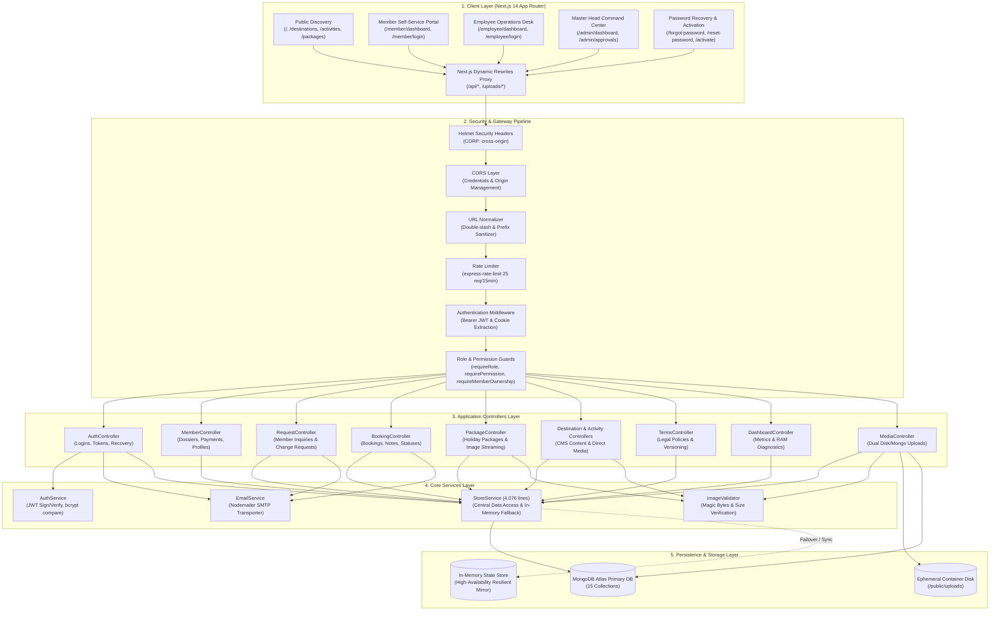
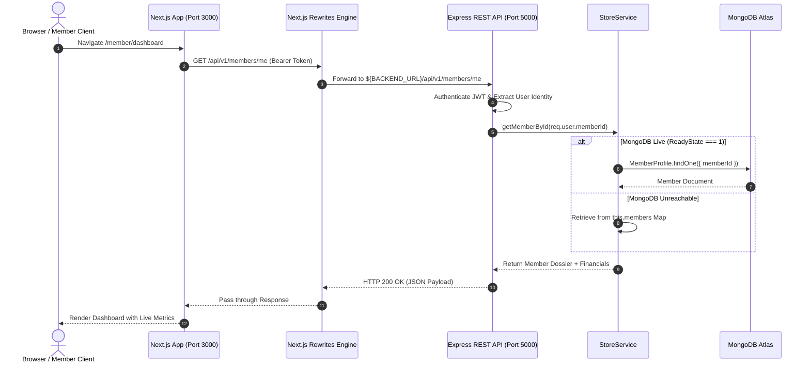
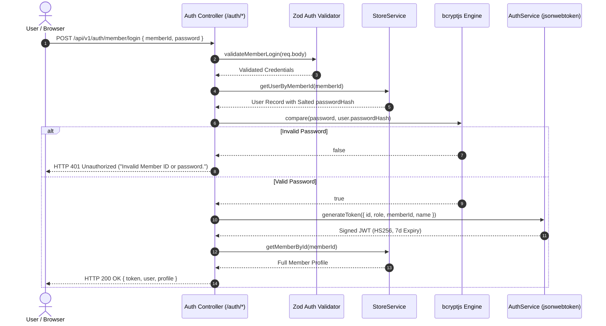
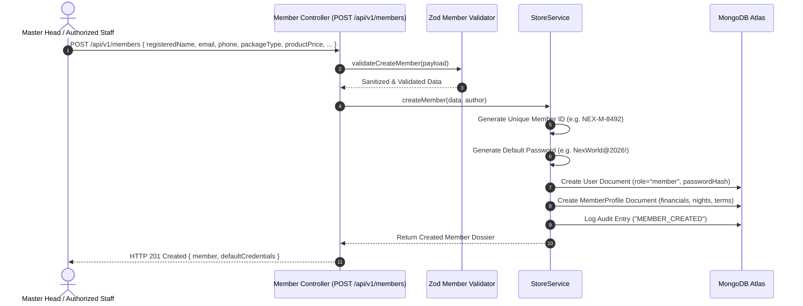
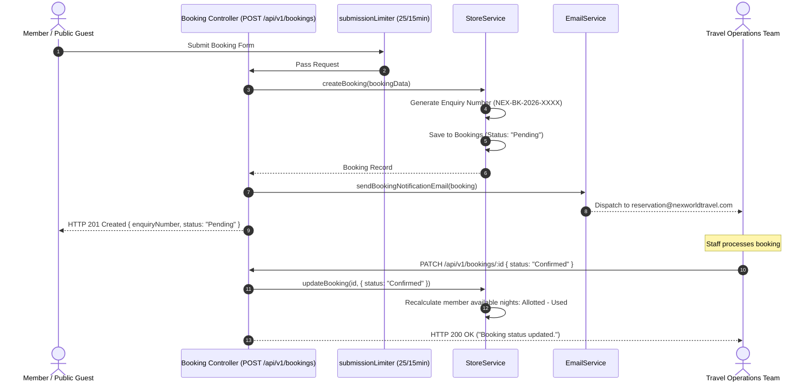
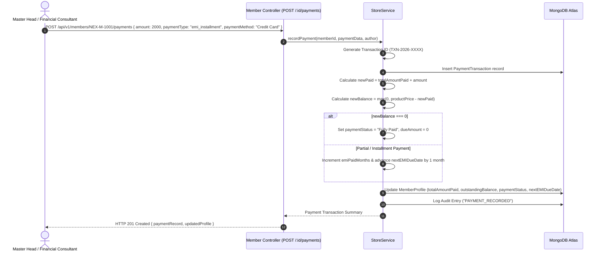
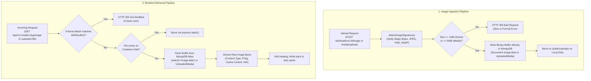
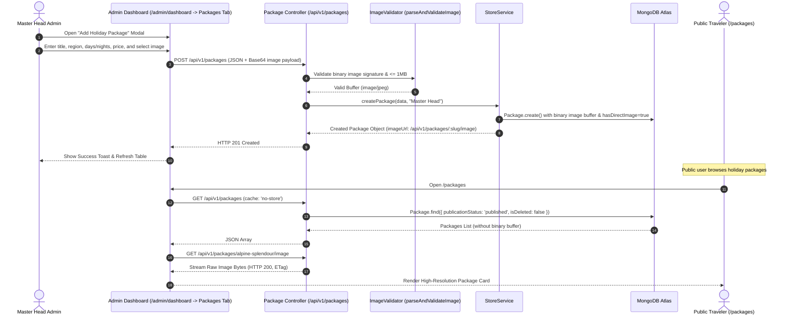
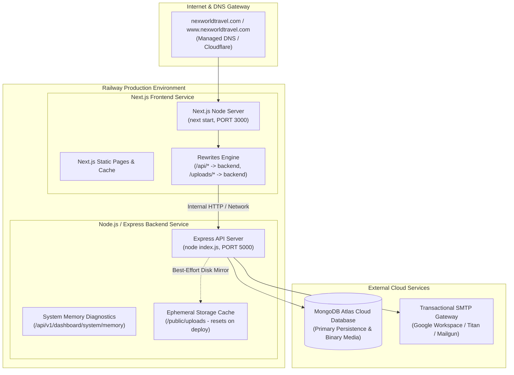

# NEXWORLD TRAVEL — SYSTEM ARCHITECTURE DOCUMENTATION (ARCHITECTURE.md)

> **Document Version**: 2.1.0  
> **Platform**: NexWorld Travel & Tourism Enterprise Web Application  
> **Architecture Status**: Verified from Repository Inspection  
> **Target Environment**: Railway Cloud Deployment (Next.js 14 + Node.js/Express + MongoDB Atlas)

---

## 1. System Overview & Technology Stack

NexWorld Travel & Tourism ([nexworldtravel.com](https://nexworldtravel.com)) is an enterprise-grade luxury travel management platform designed to service members, travel consultants, and administrative executives. The platform operates on a decoupled client-server architecture with dynamic same-origin proxy rewrites, dual-layer persistent storage, and an in-browser zero-dependency PDF rendering engine.

### 1.1 Verified Technology Stack

| Layer | Technology | Version | Purpose & Implementation Details |
| :--- | :--- | :--- | :--- |
| **Frontend Framework** | Next.js (App Router) | 14.2.15 | React 18 server and client components, dynamic rewrites proxy, hybrid static generation and client rendering. |
| **Styling & Icons** | Tailwind CSS / Lucide React | 3.4.14 / 0.454.0 | Luxury branding theme, responsive layouts, accessible UI icons. |
| **Animation** | Framer Motion | 11.11.17 | Interactive transitions, carousel animations, modal viewports. |
| **Backend Runtime** | Node.js (ES Modules) | 20.x | High-throughput asynchronous runtime utilizing native ES Modules (`"type": "module"`). |
| **API Framework** | Express.js | 4.21.1 | REST API micro-routes, centralized middleware pipeline, static uploads serving with binary fallbacks. |
| **Database** | MongoDB Atlas | Mongoose 8.7.2 | Document database with custom connection pooling, schema validations, and binary media buffer storage. |
| **Resilient Persistence** | Hybrid Store (`storeService.js`) | Custom | In-memory operational store acting as immediate zero-downtime failover if MongoDB connectivity drops. |
| **Security & Auth** | JWT & bcryptjs | 9.0.3 / 3.0.3 | Stateless SHA-256 JWT sessions, 10-round salted bcrypt password hashing, HTTP-only cookie support. |
| **Input Validation** | Zod | 3.23.8 | Strict server-side schema validation on all mutations (members, bookings, contacts, change requests). |
| **Transactional Email** | Nodemailer | 10.2.1 | Multi-destination transactional SMTP dispatcher with simulated fallbacks. |
| **Hosting Platform** | Railway | PaaS | Decoupled Node.js backend service and Next.js frontend with ephemeral container disks. |

---

## 2. Complete System Architecture & Module Boundaries



---

## 3. Frontend-to-Backend Request Flow & Reverse Proxy

All client-side API requests and media asset requests route through the Next.js `rewrites()` reverse proxy configured in `client/next.config.mjs`. This architecture ensures same-origin communication, eliminating cross-origin CORS preflight latency in production and concealing the backend Railway service URL.



---

## 4. Authentication Architecture & Session Lifecycle

Authentication supports three distinct personas:
1. **Members**: Login using unique uppercase **Member ID** (e.g. `NEX-M-1001`) and password via `/api/v1/auth/member/login`.
2. **Employees / Travel Consultants**: Login using corporate email (e.g. `staff@nexworldtravel.com`) and password via `/api/v1/auth/staff/login`.
3. **Master Head Administrators**: Login using executive email (e.g. `admin@nexworldtravel.com`) and password via `/api/v1/auth/staff/login`.



---

## 5. Master Head & Employee Maker-Checker Permission Governance

To prevent unauthorized tampering with client financial contracts, package tiers, and room night entitlements, operational staff operate under a maker-checker engine. Staff can directly edit permitted contact information (phone, address), but any modification to packages, nights, or financials requires formal proposal submission.

```mermaid
sequenceDiagram
    autonumber
    actor Staff as Travel Consultant (Employee)
    participant Portal as Employee Portal (/employee/dashboard)
    participant API as Request Controller (/change-requests)
    participant Store as StoreService
    participant DB as MongoDB Atlas
    actor MasterHead as Master Head Admin (/admin/approvals)

    Staff->>Portal: Propose Night Allocation Increase (+5 Nights)
    Portal->>API: POST /api/v1/change-requests { memberId, proposedValue, reason }
    API->>Store: createChangeRequest(data, employee)
    Store->>DB: Insert into EmployeeChangeRequests (Status: "Pending")
    Store-->>API: Created Request (CR-2026-XXXX)
    API-->>Portal: HTTP 201 Created ("Submitted for Master Head review")

    Note over MasterHead: Master Head reviews pending requests in real time
    MasterHead->>API: GET /api/v1/change-requests?status=Pending
    API->>DB: Fetch pending change requests
    DB-->>API: Requests List
    API-->>MasterHead: Display Side-by-Side Diff (Current vs. Proposed)

    alt Master Head Approves
        MasterHead->>API: POST /api/v1/change-requests/:id/approve
        API->>Store: approveChangeRequest(id, reviewer)
        Store->>DB: Update MemberProfile with proposedValue
        Store->>DB: Update EmployeeChangeRequests status="Approved"
        Store->>DB: Append to AuditLogs collection
        API-->>MasterHead: HTTP 200 OK ("Approved and applied.")
    else Master Head Rejects
        MasterHead->>API: POST /api/v1/change-requests/:id/reject { reason }
        API->>Store: rejectChangeRequest(id, reviewer, reason)
        Store->>DB: Update EmployeeChangeRequests status="Rejected"
        API-->>MasterHead: HTTP 200 OK ("Request rejected; member untouched.")
    end
```

---

## 6. Member Registration Lifecycle

New members can be registered by the Master Head or by employees with the `create_member` permission.



---

## 7. Booking Management & Room Night Entitlement Lifecycle



---

## 8. Financial Reconciliation & EMI Management Lifecycle

Financial operations enforce deterministic balance reconciliation and installment schedule management across AED currency contracts.



---

## 9. Permanent Image Storage & Media Delivery Pipeline

The media storage architecture protects uploaded assets from ephemeral cloud container wipe-outs. Images are stored in MongoDB as binary buffers (`hasDirectImage: true` / `UploadedMedia`), served with ETags, and mirrored to disk for high-performance static caching.



---

## 10. Holiday Package Content Management Workflow

Holiday Package management is exclusively restricted to Master Head administrators (`requireRole('master_head')`).



---

## 11. Railway Cloud Deployment Architecture & Ephemerality Handling



---

## 12. Architectural Limitations & Technical Debt Boundaries

While the current architecture delivers high resilience and fast sub-100ms response times, the following limitations are documented for future architectural evolution:

1. **Monolithic Store Service (`storeService.js`)**: At 4,076 lines, `storeService.js` handles data access, in-memory mirroring, business calculations, and audit logging for all 15 domains. It should be refactored into domain repositories.
2. **In-Memory Security Tokens**: Password reset tokens and account activation tokens reside in an in-memory `Map` on the Node process. Process restarts invalidate unconsumed tokens.
3. **Password Reset Token In HTTP Response**: In `authController.js`, password reset tokens are returned directly in the JSON response for debugging/testing convenience, presenting a critical security risk.
4. **Non-Atomic Payment Updates**: `recordPayment` updates `PaymentTransaction` and `MemberProfile` in separate non-transactional database operations. Under high concurrency or network partition, transaction records and member balances could diverge.
5. **Enquiry-Level Night Deductions**: `calculateMemberNights` sums stay nights from all active bookings including unconfirmed enquiries (`Pending`, `New`), deducting room nights before administrative confirmation.
