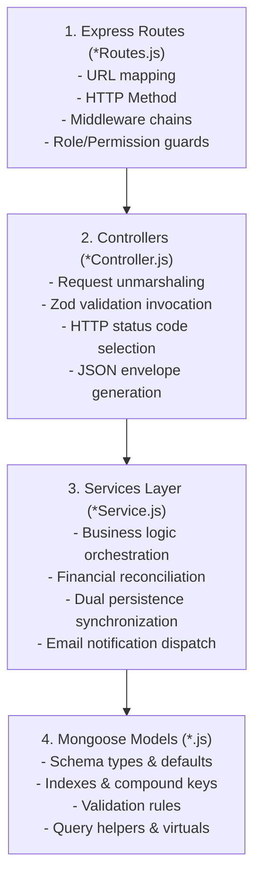

# NEXWORLD TRAVEL — CODE CONVENTIONS & ENGINEERING STANDARDS (CONVENTIONS.md)

> **Document Version**: 2.0.0  
> **Target Audience**: All Software Engineers & Autonomous AI Coding Agents  
> **Status**: Active Project Standard

---

## 1. Naming Conventions

### 1.1 Files & Directories
- **React Components & Pages**: PascalCase for standalone components (`BookingForm.jsx`, `Navbar.jsx`, `AvailabilityCalendar.jsx`). Next.js App Router conventions require lowercase filenames for routing primitives (`page.jsx`, `layout.jsx`, `loading.jsx`, `error.jsx`, `not-found.jsx`).
- **Dynamic Next.js Route Folders**: Bracket notation in kebab-case (`[slug]/page.jsx`, `[id]/page.jsx`).
- **Backend Routes & Controllers**: camelCase suffixed with layer descriptor (`memberRoutes.js`, `memberController.js`, `authValidator.js`).
- **Database Models**: PascalCase matching the Mongoose model identifier (`MemberProfile.js`, `PaymentTransaction.js`, `Destination.js`).
- **Utility & Service Modules**: camelCase (`storeService.js`, `emailService.js`, `pdfExport.js`, `currency.js`).
- **Test Files**: kebab-case or camelCase suffixed with `.test.js` (`api.test.js`, `clientCorrections.test.js`, `holidayPackageAndImageStorage.test.js`).

### 1.2 Variables & Functions
- **Variables & Constants**: camelCase for runtime variables (`currentDue`, `activeBookings`, `selectedPlan`). UPPER_SNAKE_CASE for compile-time constants and enum definitions (`ALL_PERMISSIONS`, `MAX_IMAGE_SIZE_BYTES`, `REQUEST_TYPES`).
- **Functions & Methods**: camelCase with descriptive action prefixes:
  - Retrieval: `getMemberById()`, `fetchDestinations()`, `getUserByEmail()`
  - Creation: `createMember()`, `recordPayment()`, `submitBookingEnquiry()`
  - Mutation: `updateMember()`, `toggleEmployeeStatus()`, `approveChangeRequest()`
  - Deletion: `deletePackage()`, `deleteActivity()`
  - Predicates: `isMongoLive()`, `hasPermission()`, `verifyToken()`
- **React State Hooks**: `[value, setValue]` pairing (`[loading, setLoading]`, `[showModal, setShowModal]`).

### 1.3 Database & API Field Naming
- **MongoDB Fields**: camelCase matching JavaScript idioms (`memberId`, `totalAmountPaid`, `availableNights`, `nextEMIDueDate`, `publicationStatus`).
- **Virtuals & Legacy Compatibility**: Maintain explicit virtual getters for historical API compatibility (`nightsAvailable` virtual mapping to `availableNights`).
- **API URL Paths**: kebab-case for multi-word REST resources (`/change-requests`, `/member-requests`, `/forgot-password`, `/activate-account`).

---

## 2. Localization, Currency & Domain Standards

### 2.1 Currency & Monetary Precision (AED)
NexWorld Travel operates in the United Arab Emirates with all monetary values denominated in **UAE Dirhams (AED)**.
- **Authoritative Display Helper**: Always use `formatAED(amount)` from [client/lib/currency.js](file:///home/harshvardhan/Desktop/Nexworldtravel/client/lib/currency.js).
- **Backend Storage**: Store monetary values as raw floating-point numbers or integers in MongoDB (`productPrice: 24000`, `totalAmountPaid: 16000`). Never store currency symbols or formatted strings in the database.
- **Frontend Display**: Always prefix with `AED ` followed by locale-formatted thousand separators (e.g., `AED 24,000`).
- **Zero Values**: Display `AED 0` for 0 or nullish amounts. Never display empty strings, `AED NaN`, or `AED undefined`.
- **Parsing**: Use `parseAED(string)` when parsing user-submitted currency strings from inputs.

### 2.2 Date, Time & Timezone Handling (UAE Standard Time)
- **Timezone**: All operational dates, timestamps, and customer facing notifications reference UAE Standard Time (**Gulf Standard Time, GST, UTC+4** / `Asia/Dubai`).
- **Storage Format**: Store all database timestamps in standardized **ISO-8601 UTC strings** (`new Date().toISOString()`, e.g. `2026-11-26T17:15:00.000Z`).
- **Display Formatting**: In PDF exports and user dashboards, format dates using `en-GB` with `timeZone: 'Asia/Dubai'` (`26 Nov 2026, 09:15 PM GST`).
- **Booking Date Intervals**: Store customer check-in and check-out dates as `YYYY-MM-DD` strings to prevent accidental timezone offsets altering intended calendar days.

### 2.3 Member ID Format & Normalization
- **Canonical Format**: `NEX-M-XXXX` (Prefix `NEX`, category `M` for Member, hyphenated 4-digit code, e.g. `NEX-M-1001`, `NEX-M-8492`).
- **Normalization Invariant**: All lookups and queries against Member ID must normalize to uppercase trimmed strings:
  ```javascript
  const canonicalId = String(memberId).trim().toUpperCase();
  ```
- **Login Compatibility**: Member login must accept lowercase input from users and normalize before database matching.

### 2.4 International Telephone Number Formatting
- **Standard**: Store phone numbers with international dialing codes in E.164-compatible or standardized international format (`+971 50 123 4567`, `+971 2 639 5908`).
- **Validation**: Reject pure local numbers without country context during registration to prevent delivery failures during SMS or WhatsApp concierge communications.

---

## 3. Image & Media Conventions

### 3.1 Media Uploads & Direct Binary Image Storage
- **Size Limits**:
  - Direct Entity Images (Destinations, Activities, Packages): Strictly $\le 1.0 \text{ MB}$ ($1,048,576 \text{ bytes}$).
  - Generic Media Uploads (`/api/v1/media/upload`): Strictly $\le 5.0 \text{ MB}$ ($5,242,880 \text{ bytes}$).
- **Allowed MIME Formats**: `image/jpeg`, `image/jpg`, `image/png`, `image/webp`.
- **Magic Byte Validation**: Always validate binary headers using `detectImageSignature()` from [server/src/utils/imageValidator.js](file:///home/harshvardhan/Desktop/Nexworldtravel/server/src/utils/imageValidator.js). Never trust file extensions alone.
- **Generated File Names**: Formatted as `${sanitizedSlug}-${Date.now()}-${randomHex}.${ext}` (e.g. `arabian-nights-village-1793286066253-972b30.jpg`).
- **Public URL Conventions**:
  - Direct Streaming: `/api/v1/:model/:slug/image` (e.g. `/api/v1/destinations/azerbaijan/image`)
  - Uploads Fallback: `/uploads/:filename` (e.g. `/uploads/IMG-20250217-WA0144-1793262352561-9604fc.jpg`)

---

## 4. Architectural Layer Responsibilities



### 4.1 Controllers
- Must not execute raw database queries or complex business logic directly.
- Must unmarshal inputs, validate with Zod schemas, call appropriate service methods, and return uniform JSON responses.
- Must delegate errors to `next(error)` for centralized handling.

### 4.2 Services (`storeService.js`, etc.)
- Hold all business logic (balance calculations, night entitlements, maker-checker diffing).
- Manage dual-mode persistence (MongoDB Atlas primary + in-memory store fallback).
- Append audit log entries for all significant administrative mutations.

### 4.3 Standard HTTP Response Envelopes
All REST API endpoints must return structured JSON envelopes:

```javascript
// Success Response
{
  "success": true,
  "message": "Member profile updated successfully.",
  "data": { ... } // or entity key e.g. "member": { ... }
}

// Error Response
{
  "success": false,
  "message": "Human-readable failure description.",
  "errors": [ ... ] // Optional detailed field errors
}
```

---

## 5. Coding Standards: Current vs. Proposed

| Topic | Current Codebase Pattern | Proposed Senior Standard |
| :--- | :--- | :--- |
| **Data Access** | Monolithic `storeService.js` handling all 15 domains | Decoupled Domain Repositories (`MemberRepository`, `BookingRepository`, etc.) |
| **Token Storage** | In-memory `Map` on Node process | MongoDB-backed TTL collection with SHA-256 token hashing |
| **Password Reset** | Plaintext reset token returned in HTTP response | Token dispatched ONLY via transactional email; zero token in response |
| **Financial Writes** | Separate `PaymentTransaction.create()` and `updateMember()` | MongoDB Multi-Document Transactions (`session.startTransaction()`) |
| **Night Deduction** | Pending enquiries deduct room nights automatically | Only `Confirmed` or `Approved` bookings deduct room nights |
| **Client PDF Export** | Client-side Canvas-to-PDF binary stream | Preserved (Zero server RAM overhead, excellent Railway fit) |
