# NEXWORLD TRAVEL — DATABASE ARCHITECTURE & SCHEMA REFERENCE (DATABASE.md)

> **Document Version**: 2.0.0  
> **Database Engine**: MongoDB Atlas (MongoDB 7.0 / 8.0 Compatible)  
> **Object Document Mapper**: Mongoose 8.7.2  
> **Status**: Verified from Actual Model Declarations

---

## 1. Database Architecture & Persistence Strategy

The NexWorld Travel database architecture combines MongoDB Atlas cloud document persistence with a high-availability in-memory fallback layer (`storeService.js`). 

### 1.1 Key Architectural Characteristics
- **Hybrid Resilience**: In the event of network partition or credential rotation with MongoDB Atlas, the backend automatically falls back to an in-memory active store without crashing, maintaining read/write uptime for active sessions.
- **Embedded Binary Media**: To solve ephemeral container disk wipes on cloud hosting (Railway), image buffers (JPEG, PNG, WebP) are embedded directly within MongoDB documents (`Destination.image.data`, `Activity.image.data`, `Package.image.data`, and `UploadedMedia.data`) with `{ select: false }` to avoid memory bloat during directory queries.
- **Normalized Financials**: Total contract price, amount paid, and outstanding balances are stored at the member level, while discrete installment transactions are recorded in an immutable ledger (`PaymentTransaction`).

---

## 2. Complete Entity-Relationship (ER) Diagram

```mermaid
erDiagram
    User ||--o| MemberProfile : "identifies (1:1)"
    User ||--o| EmployeePermission : "grants (1:1)"
    User ||--o{ AuditLog : "triggers"
    User ||--o{ EmployeeChangeRequest : "submits/reviews"
    
    MemberProfile ||--o{ PaymentTransaction : "accrues payments"
    MemberProfile ||--o{ Booking : "makes bookings"
    MemberProfile ||--o{ MemberRequest : "submits tickets"
    MemberProfile ||--o{ EmployeeChangeRequest : "subject of change"

    Destination ||--o{ Booking : "destination booked"
    Package ||--o{ Booking : "package booked"
    PlanAvailability }|--|| MemberProfile : "targets tier or member"

    User {
        Mixed _id PK
        string role "member | employee | master_head"
        string memberId "UK (sparse, uppercase)"
        string email "UK (sparse, lowercase)"
        string passwordHash "bcrypt hash"
        string name
        string phone
        boolean isActive "default: true"
        date lastLogin
        boolean mustChangePassword
    }

    MemberProfile {
        Mixed _id PK
        Mixed userId FK "references User"
        string memberId UK "e.g. NEX-M-1001"
        string registeredName
        string email
        string phone
        string address
        string packageType "Titanium | Platinum+ | Gold | Silver | Trail Plan | etc."
        number productPrice "AED currency"
        number totalAmountPaid "AED currency"
        number outstandingBalance "AED currency"
        number allottedNights "Entitlement pool"
        number usedNights "Deducted stay nights"
        number availableNights "Calculated balance"
        boolean hasEMI "EMI eligibility"
        number emiAmount "Monthly AED"
        number emiTenureMonths
        number emiPaidMonths
        date nextEMIDueDate
        number dueAmount "Current installment balance"
        string paymentStatus "Up to Date | Due Soon | Overdue | Fully Paid"
        string membershipStatus "Active | InActive | Cancel | etc."
        string tenurePeriod "e.g. 5 Years"
        boolean travelCardBenefit
        date purchaseDate
        date registrationDate
        boolean termsAccepted
        date termsAcceptedAt
        string termsVersion
    }

    PaymentTransaction {
        Mixed _id PK
        string transactionId UK "TXN-YYYY-XXXX"
        string memberId FK "references MemberProfile"
        number amount "AED currency"
        string paymentType "down_payment | emi_installment | lump_sum | refund"
        string paymentMethod "Bank Transfer | Credit Card | POS Swipe | etc."
        string referenceNumber
        string notes
        string recordedBy "Staff / Master Head name"
        date date "Transaction timestamp"
    }

    Booking {
        Mixed _id PK
        string enquiryNumber UK "NEX-BK-YYYY-XXXX"
        string referenceNumber
        string memberId FK "references MemberProfile"
        string memberName
        string customerName
        string email
        string phone
        string destinationOrPackage
        string travelDate
        string returnDate
        number adults
        number children
        number numberOfNights "Stay nights"
        string activitiesRequired
        string status "Pending | New | Contacted | Confirmed | Approved | Cancelled"
        string notes
    }

    Package {
        Mixed _id PK
        string title
        string slug UK "kebab-case"
        string destination
        string region
        number durationDays
        number durationNights
        number price "AED quotation base"
        string coverImage
        string imageUrl
        buffer image_data "Binary buffer (select: false)"
        string image_contentType
        boolean hasDirectImage
        boolean featured
        string publicationStatus "published | draft | archived"
        boolean isDeleted
        string createdBy
        string updatedBy
    }

    Destination {
        Mixed _id PK
        string title
        string slug UK "kebab-case"
        string region
        string category "Dream Destinations | Top Destinations"
        string description
        string coverImage
        string imageUrl
        buffer image_data "Binary buffer (select: false)"
        string image_contentType
        boolean hasDirectImage
        string publicationStatus "published | draft | archived"
        boolean isDeleted
    }

    Activity {
        Mixed _id PK
        string title
        string slug UK "kebab-case"
        string category "Desert & Safari | Marine | Cultural"
        string region
        string location
        string description
        string duration
        string intensity "Easy | Moderate | High | All Ages"
        buffer image_data "Binary buffer (select: false)"
        boolean hasDirectImage
        string publicationStatus "published | draft"
        boolean isDeleted
    }

    UploadedMedia {
        ObjectId _id PK
        string filename UK "img-timestamp-hex.ext"
        string originalName
        string contentType "image/jpeg, image/png, etc."
        number size "Bytes"
        buffer data "Binary image data"
        string uploadedBy
    }

    EmployeePermission {
        Mixed _id PK
        Mixed userId FK "references User"
        string email
        string[] permissions "14 permission keys"
        string assignedBy
    }

    EmployeeChangeRequest {
        string requestId UK "CR-YYYY-XXXX"
        ObjectId employeeId FK "references User"
        string employeeName
        string entityType "member_details | membership_plan | financial"
        string targetId "references MemberProfile"
        mixed currentValue
        mixed proposedValue
        string reason
        string status "Pending | Approved | Rejected"
        ObjectId reviewedBy FK
        string rejectionReason
        date reviewedAt
    }

    PlanAvailability {
        Mixed _id PK
        string memberId "ALL or specific memberId"
        string title
        string destinationOrPlan
        string packageTier "All | Titanium | Platinum | Gold | Silver | Trail Plan"
        string startDate "YYYY-MM-DD"
        string endDate "YYYY-MM-DD"
        boolean isAvailable
        number availableSeats
        number bookedSeats
    }

    TermsCondition {
        ObjectId _id PK
        string version UK "e.g. v1.0-2026"
        string title
        string content "Full legal policy text"
        boolean isActive
        string updatedBy
    }

    MemberRequest {
        string requestReference UK "REQ-YYYY-XXXX"
        string memberId FK "references MemberProfile"
        string memberName
        string memberEmail
        string requestType "Booking Assistance | Plan Upgrade | etc."
        string subject
        string message
        string status "Pending | In Review | Resolved | Closed"
    }

    AuditLog {
        ObjectId _id PK
        string action "MEMBER_CREATED, PAYMENT_RECORDED, etc."
        string performedBy "User email / identifier"
        string role "master_head | employee | system"
        string targetEntity "member | financial | destination"
        string targetId
        mixed details
        string ipAddress
    }

    Contact {
        ObjectId _id PK
        string ticketNumber UK "CNT-YYYY-XXXX"
        string fullName
        string email
        string phone
        string subject
        string message
        string status "unread | responded | resolved"
    }
```

---

## 3. Detailed Collection Schemas

### 3.1 `users` Collection (Model: `User`)
- **Primary Key**: `_id` (`mongoose.Schema.Types.Mixed`)
- **Indexes**:
  - `memberId`: Sparse, uppercase index for rapid member authentication.
  - `email`: Sparse, lowercase index for staff and master head login.
  - `role`: Standard index.
  - `isActive`: Standard index.
- **Security Method**: Overrides `toJSON()` to automatically strip `passwordHash` from all query responses.

### 3.2 `memberprofiles` Collection (Model: `MemberProfile`)
- **Primary Key**: `_id` (`Mixed`)
- **Foreign Key**: `userId` (`ref: 'User'`)
- **Indexes**:
  - `memberId`: Unique index (e.g. `NEX-M-1001`).
  - `registeredName`: Standard index.
  - `email`: Lowercase standard index.
  - `packageType`: Standard index.
  - Compound Text Search Index: `{ memberId: 'text', registeredName: 'text', email: 'text', phone: 'text' }` for instant search over 5,000+ members.
- **Virtuals**: `nightsAvailable` virtual getter mapping to `availableNights` for legacy frontend compatibility.

### 3.3 `paymenttransactions` Collection (Model: `PaymentTransaction`)
- **Primary Key**: `_id` (`Mixed`)
- **Indexes**:
  - `transactionId`: Unique uppercase index (`TXN-YYYY-XXXX`).
  - `memberId`: Uppercase index referencing member.
  - `date`: Timestamp index for chronological ledger sorting.
- **Allowed Payment Methods**: Cash, Credit Card, Debit Card, Card Machine / POS (Card Swipe), POS Swipe, Bank Transfer, Online Payment, Payment Link, Cheque, Tabby, Tamara, Account Adjustment, Other.

### 3.4 `bookings` Collection (Model: `Booking`)
- **Primary Key**: `_id` (`Mixed`)
- **Indexes**:
  - `enquiryNumber`: Unique uppercase index (`NEX-BK-YYYY-XXXX`).
  - `referenceNumber`: Standard index.
  - `memberId`: Standard index.
  - `email`: Lowercase index.
  - `status`: Standard index.

### 3.5 Media & Content Collections (`packages`, `destinations`, `activities`, `uploadedmedias`)
- **Direct Image Buffer Storage**:
  - Field: `image.data` with type `Buffer` and schema declaration `{ select: false }`.
  - Ensures queries for package cards or destination catalogs transfer lightweight JSON metadata (~2 kB) without sending multi-megabyte image buffers.
  - Images are explicitly streamed by dedicated endpoints using `.select('+image.data')`.

---

## 4. Potential Database Integrity Risks & Remediation Plan

The code audit identified the following database risks:

| Risk Category | Finding & Evidence | Business & Data Risk | Remediation Recommendation |
| :--- | :--- | :--- | :--- |
| **Non-Atomic Payments** | In `storeService.js:1477`, `PaymentTransaction.create()` and `updateMember()` execute in separate non-transactional calls. | If the server crashes or network partitions between calls, money is recorded in transactions without reducing member balance. | Wrap payment recording inside MongoDB Multi-Document Transactions (`session.startTransaction()`). |
| **Race Conditions on Balance** | `updateMember()` overwrites `totalAmountPaid` with calculated value rather than atomic increment. | Concurrent staff payment submissions can overwrite each other's updates. | Use atomic MongoDB operators: `$inc: { totalAmountPaid: amount, outstandingBalance: -amount }`. |
| **Enquiry Night Deductions** | `calculateMemberNights` counts stay nights for all bookings whose status is not cancelled/rejected. | Unconfirmed enquiries (status "Pending" or "New") reduce member available room nights before confirmation. | Only subtract nights for bookings with status `Confirmed`, `Approved`, or `Completed`. |
| **In-Memory Security Tokens** | `securityTokens` in `storeService.js:724` uses an in-memory `Map()`. | Container restarts on Railway wipe active password reset and activation tokens. | Create a MongoDB collection `securitytokens` with TTL indexes (`expiresAfterSeconds: 3600`). |
| **Transaction ID Collisions** | `generateCode('TXN')` generates 4-digit random numbers ($1000$ to $9999$). | Under volume exceeding a few hundred payments per year, collision probability increases rapidly. | Use crypto UUIDs or nanoids with sufficient entropy (`crypto.randomBytes(6).toString('hex')`). |
