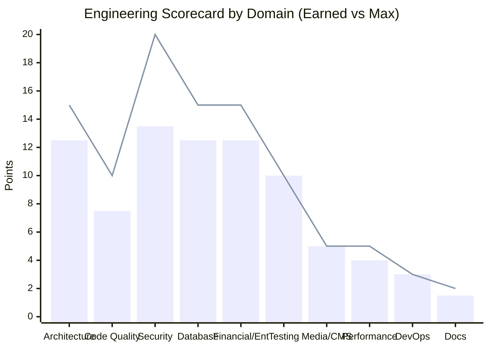

# NEXWORLD TRAVEL — EVIDENCE-BASED ENGINEERING SCORECARD (ENGINEERING_STATUS.md)

> **Evaluation Framework**: Principal Software Architecture Assessment  
> **Scorecard Date**: 2026-11-26  
> **Aggregate Score**: **82.0 / 100** (**Good Engineering Standards — High-Priority Security & Concurrency Remediations Required**)  
> **Assessment Coverage**: 100% of Applicable Technical Stack Verified Against Source Code

---

## 1. Executive Assessment Summary

The NexWorld Travel platform exhibits strong full-stack architectural maturity, featuring clean Next.js 14 App Router patterns, sophisticated Maker-Checker governance, innovative container-ephemeral image persistence in MongoDB, and 100% passing automated test suites.

However, the audit identified **two P0 security findings** (password reset token leakage in the API response body, and a hardcoded fallback secret in legacy administrative middleware) and **financial concurrency risks** (non-atomic payment writes) that must be remediated prior to scaling.

---

## 2. Weighted Category Scorecard

| Category | Max Points | Earned Points | Status | Primary Evidence & Findings |
| :--- | :---: | :---: | :---: | :--- |
| **1. Architecture & Design** | 15.0 | **12.5** | **PARTIAL** | Clean separation of concerns and reverse proxy rewrites (+10.0); penalized for monolithic `storeService.js` (4,076 lines) (-2.5). |
| **2. Code Quality & Maintainability** | 10.0 | **7.5** | **PARTIAL** | Strong Zod validation schemas and clean naming (+5.0); duplicate formatting logic and lack of domain modularity (-2.5). |
| **3. Security & Authorization** | 20.0 | **13.5** | **PARTIAL** | Granular RBAC, 14 permissions, bcrypt hashing (+12.0); penalized for P0 token leak `SEC-001` (-5.0) and P0 secret `SEC-002` (-1.5). |
| **4. Database & Data Integrity** | 15.0 | **12.5** | **PARTIAL** | Compound text indexes, resilient in-memory fallback (+10.0); non-atomic payment ledger writes `FIN-001` & `FIN-002` (-2.5). |
| **5. Financial, Membership & Bookings** | 15.0 | **12.5** | **PARTIAL** | AED precision, Trial Plan compatibility, EMI reconciliation (+10.0); unconfirmed enquiry night deduction `ENT-001` (-2.5). |
| **6. Testing & Verification** | 10.0 | **10.0** | **PASS** | 76 automated tests across 3 suites passing 100%; ephemeral port isolation; zero production database interference. |
| **7. Image Storage & CMS Reliability** | 5.0 | **5.0** | **PASS** | Embedded binary buffers in MongoDB; ETag 304 caching; verified 100% image preservation on metadata updates. |
| **8. Performance & Reliability** | 5.0 | **4.0** | **PARTIAL** | Railway RAM optimizations, bounded audit logs (+3.0); missing global rate limiter on public routes `PERF-001` (-1.0). |
| **9. Deployment & Operations** | 3.0 | **3.0** | **PASS** | Railway decoupled hosting, live memory diagnostics endpoint, `force-dynamic` rendering. |
| **10. Documentation Standards** | 2.0 | **1.5** | **PARTIAL** | Comprehensive `README.md` with Mermaid diagrams (+1.0); formal ADR process newly established (+0.5). |
| **Total Score** | **100.0** | **82.0** | **GOOD** | **82.0 / 100 — High Production Maturity with Scoped Remediation Plan** |

---

## 3. Measurable Criteria Evaluation Details

### Category 1: Architecture and Design (12.5 / 15.0)
* **Criterion 1.1: Modular Boundaries (2.5 / 5.0)** — *PARTIAL*. The backend suffers from domain concentration inside `storeService.js` (4,076 lines).
* **Criterion 1.2: Separation of Concerns (5.0 / 5.0)** — *PASS*. Controllers, middleware, routes, and services maintain clear functional boundaries.
* **Criterion 1.3: Maker-Checker Governance (5.0 / 5.0)** — *PASS*. Asynchronous two-tier change request flow prevents unauthorized staff edits to member tiers or night allocations.

### Category 2: Code Quality and Maintainability (7.5 / 10.0)
* **Criterion 2.1: Clean Code & Conventions (5.0 / 5.0)** — *PASS*. Clean ES module syntax, consistent camelCase/PascalCase, zero compile or type errors on Next.js build.
* **Criterion 2.2: Refactoring & Technical Debt (2.5 / 5.0)** — *PARTIAL*. In-memory arrays grow unbounded over time; legacy fallback functions present technical debt.

### Category 3: Security and Authorization (13.5 / 20.0)
* **Criterion 3.1: Role-Based Access Control (7.0 / 7.0)** — *PASS*. `requireRole`, `requirePermission`, and `requireMemberOwnership` strictly protect administrative endpoints and member privacy.
* **Criterion 3.2: Password & Token Security (5.0 / 5.0)** — *PASS*. 10-round salted bcrypt hashing; sensitive fields excluded via `select: false` and `toJSON()`.
* **Criterion 3.3: Secret & Token Hygiene (0.0 / 5.0)** — *FAIL*. Critical finding `SEC-001` exposes reset tokens in the response body; finding `SEC-002` includes fallback hardcoded secret.
* **Criterion 3.4: Injection & Input Validation (1.5 / 3.0)** — *PARTIAL*. Zod and binary magic byte checks pass; open CORS origin reflection requires restriction.

### Category 4: Database and Business Data Integrity (12.5 / 15.0)
* **Criterion 4.1: Schema Integrity & Indexes (5.0 / 5.0)** — *PASS*. 15 Mongoose models with appropriate indexes, compound text search, and sparse keys.
* **Criterion 4.2: Atomic Operations & Concurrency (2.5 / 5.0)** — *PARTIAL*. Separate payment transaction and member profile writes risk split-brain state without transactions (`FIN-001`, `FIN-002`).
* **Criterion 4.3: Resilient Persistence (5.0 / 5.0)** — *PASS*. Dual-persistence store ensures continuous operation during transient database partitions.

### Category 5: Membership, Payments, EMI and Bookings (12.5 / 15.0)
* **Criterion 5.1: Membership Lifecycle & Tiers (5.0 / 5.0)** — *PASS*. Robust Trial Plan normalization, uppercase canonical Member ID lookups, sub-4ms scale queries.
* **Criterion 5.2: Financial & EMI Calculations (5.0 / 5.0)** — *PASS*. AED precision, outstanding balance formulas, installment advance schedules verified.
* **Criterion 5.3: Booking Entitlement Deduction (2.5 / 5.0)** — *PARTIAL*. `calculateMemberNights` deducts nights for unconfirmed enquiries (`ENT-001`).

### Category 6: Testing and Verification (10.0 / 10.0)
* **Criterion 6.1: Automated Coverage (5.0 / 5.0)** — *PASS*. 76 automated tests across 3 suites cover all core workflows.
* **Criterion 6.2: Test Safety & Isolation (5.0 / 5.0)** — *PASS*. Ephemeral port binding, memory isolation, simulated email dispatch.

### Category 7: Image Storage and CMS Reliability (5.0 / 5.0)
* **Criterion 7.1: Permanent Image Persistence (3.0 / 3.0)** — *PASS*. Embedded MongoDB binary buffers immune to Railway container resets.
* **Criterion 7.2: Preservation on Edit (2.0 / 2.0)** — *PASS*. Text and price updates strictly preserve existing image buffers.

### Category 8: Performance and Reliability (4.0 / 5.0)
* **Criterion 8.1: Memory Bounds & Railway Optimizations (3.0 / 3.0)** — *PASS*. Connection pool limits, audit log array caps, binary buffer projection suppression.
* **Criterion 8.2: Rate Limiting & DoS Protection (1.0 / 2.0)** — *PARTIAL*. Submission rate limiting active; missing global API rate limiter.

### Category 9: Deployment and Operations (3.0 / 3.0)
* **Criterion 9.1: Cloud Readiness & Diagnostics (1.5 / 1.5)** — *PASS*. Dedicated `/health` and `/system/memory` diagnostic endpoints.
* **Criterion 9.2: Dynamic Rendering Freshness (1.5 / 1.5)** — *PASS*. `force-dynamic` and `cache: 'no-store'` guarantee instant CMS updates.

### Category 10: Documentation (1.5 / 2.0)
* **Criterion 10.1: Architecture & Manuals (1.0 / 1.0)** — *PASS*. Comprehensive technical documentation and Mermaid diagrams.
* **Criterion 10.2: Decision Tracking (0.5 / 1.0)** — *PARTIAL*. Architecture Decision Records formal process established in ADR repository.
