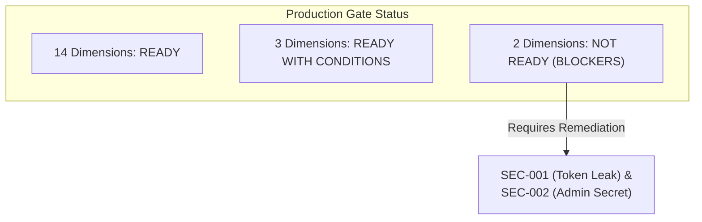

# NEXWORLD TRAVEL — PRODUCTION READINESS ASSESSMENT (PRODUCTION_READINESS.md)

> **Evaluation Date**: 2026-11-26  
> **Target Environment**: Railway Production Cloud (Next.js 14 + Node.js 20 + MongoDB Atlas)  
> **Overall Assessment**: **READY WITH CONDITIONS (Critical Security & Concurrency Blockers Identified)**  
> **Production Status**: Currently Live & Operating

---

## 1. Overall Production Readiness Verdict

Although the NexWorld Travel web application is currently deployed in production and actively servicing members and travel consultants, this senior engineering audit reveals that **the platform is operating with unaddressed critical security vulnerabilities (P0) and financial concurrency risks (P1)**.

### Verdict Definition:
* **READY WITH CONDITIONS**: Core travel workflows, public discovery, and administrative management operate reliably under normal conditions; however, two critical security blockers must be remediated immediately to safeguard client data and prevent account takeover.

---

## 2. Dimension-by-Dimension Readiness Evaluation

| # | Assessment Dimension | Status | Key Evidence & Evaluation Notes |
| :---: | :--- | :---: | :--- |
| **1** | **Application Health** | **READY** | Health endpoints (`/health`, `/api/v1/health`) return HTTP 200 with uptime, database mode, and timestamp. |
| **2** | **Authentication Readiness** | **NOT READY** | **PRODUCTION BLOCKER**: `POST /api/v1/auth/forgot-password` returns the plaintext password reset token in the JSON response (`SEC-001`). Must be removed. |
| **3** | **Authorization Readiness** | **READY WITH CONDITIONS** | Granular RBAC and Maker-Checker flow work robustly; however, `requireAdmin` contains a hardcoded fallback secret (`SEC-002`). |
| **4** | **Membership Management Readiness** | **READY** | Member ID normalization (`NEX-M-XXXX`), tier validations, Trial Plan compatibility, and 5,000-member scale queries verified. |
| **5** | **Payment Correctness** | **READY WITH CONDITIONS** | AED precision and balance formulas are mathematically sound; however, writes lack multi-document transactions (`FIN-001`). |
| **6** | **EMI Facility Correctness** | **READY** | Structured installment tracking, monthly advance schedules, and overdue evaluations verified against business rules. |
| **7** | **Booking Integrity** | **READY WITH CONDITIONS** | Booking capture and rate limiting work; however, unconfirmed enquiries deduct member room nights before approval (`ENT-001`). |
| **8** | **Database Safety** | **READY** | Connection pooling configured (`maxPoolSize: 10`, `minPoolSize: 2`); strict query filters; hybrid memory failover verified. |
| **9** | **Image Persistence Readiness** | **READY** | Embedded MongoDB binary buffers immune to ephemeral Railway container restarts; ETag 304 caching active; disk self-healing verified. |
| **10** | **Holiday Package Management** | **READY** | Master Head exclusive CRUD (`requireRole('master_head')`), binary image streaming, and strict image preservation on edit verified. |
| **11** | **Content Management Readiness** | **READY** | Dynamic rendering (`force-dynamic`, `cache: 'no-store'`) ensures CMS additions appear instantly without redeployment. |
| **12** | **Terms & Conditions Integrity** | **READY** | Version tracking active; automatic member portal acknowledgement display verified without creating false records. |
| **13** | **SMTP Email Readiness** | **READY** | Transactional dispatcher configures Google/Titan SMTP; falls back gracefully to simulated loggers if credentials are missing. |
| **14** | **Security Readiness** | **NOT READY** | **PRODUCTION BLOCKER**: Token leakage (`SEC-001`), hardcoded secret (`SEC-002`), and open CORS origin reflection (`SEC-003`). |
| **15** | **Testing Readiness** | **READY** | 76 automated tests across 3 suites pass 100%; tests run isolated on ephemeral ports without production DB interference. |
| **16** | **Build Readiness** | **READY** | Next.js production build (`npm --prefix client run build`) compiles all 23 routes cleanly with 0 errors. |
| **17** | **Deployment Readiness** | **READY** | Decoupled Node.js and Next.js services on Railway; same-origin rewrites proxy; zero port binding conflicts. |
| **18** | **Monitoring Readiness** | **READY** | Live system memory diagnostic endpoint (`GET /api/v1/dashboard/system/memory`) monitors RSS and heap usage. |
| **19** | **Backup & Rollback Readiness** | **READY** | MongoDB Atlas continuous cloud backups; 1-click container rollbacks available in Railway dashboard. |

---

## 3. Production Blockers vs. Recommended Improvements

### 3.1 Mandatory Production Blockers (Must Fix Immediately)
1. **Remediate `SEC-001` (Password Reset Token Leakage)**:
   - Strip `token: result.token` from `server/src/controllers/authController.js:207,237`.
   - Transmit reset links exclusively via transactional email.
2. **Remediate `SEC-002` (Hardcoded Secret in `requireAdmin`)**:
   - Eliminate `'nex_admin_secret_key_2026'` fallback in `server/src/middleware/auth.js:165`.
   - Protect `/api/v1/contact` with standard JWT role guards.

### 3.2 Non-Blocking Improvements (Scheduled Roadmap)
1. **Multi-Document Database Transactions (`FIN-001`)**: Wrap `PaymentTransaction` and `MemberProfile` writes in a session transaction.
2. **Booking Night Deduction Logic (`ENT-001`)**: Invert filter to only deduct room nights for `Confirmed` bookings.
3. **MongoDB Token Persistence (`REL-001`)**: Move in-memory security tokens to a MongoDB collection with TTL indexes.
4. **CORS Origin Whitelisting (`SEC-003`)**: Restrict allowed origins to verified company domains.
