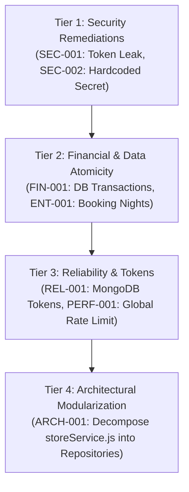

# NEXWORLD TRAVEL — PRIORITIZED TECHNICAL DEBT BACKLOG (TECHNICAL_DEBT.md)

> **Document Version**: 2.0.0  
> **Backlog Type**: Prioritized Architectural & Technical Debt Roadmap  
> **Status**: Read-Only Planning Document (Implementation Deferred)

---

## 1. Prioritization Framework & Implementation Sequence

Technical debt items are ordered strictly by business and operational risk:
1. **Tier 1 (Immediate / P0)**: Critical security vulnerabilities (Account takeover risk & secret elimination).
2. **Tier 2 (High / P1)**: Data consistency, payment transaction atomicity, and room night pool accuracy.
3. **Tier 3 (Medium / P2)**: Reliability across container restarts, global DoS rate limiting, and memory bounds.
4. **Tier 4 (Low / P3)**: Architectural modularization and long-term maintainability.

---

## 2. Technical Debt Backlog by Domain

### 2.1 Security Debt
#### TD-SEC-01: Remove Password Reset Token from HTTP Response Body
- **Problem**: `POST /api/v1/auth/forgot-password` exposes the generated password reset token in the response JSON.
- **Evidence**: [server/src/controllers/authController.js#L207,L237](file:///home/harshvardhan/Desktop/Nexworldtravel/server/src/controllers/authController.js#L207)
- **Severity**: **P0 (Critical)**
- **Business Impact**: Complete member account takeover risk without email access.
- **Client Data Risk**: Severe.
- **Recommended Improvement**: Strip `token` from both response envelopes. Transmit solely via transactional email.
- **Estimated Effort**: **Small** (15 minutes).
- **Dependencies**: None.
- **Implementation Order**: **#1 (Immediate)**.
- **Acceptance Criteria**: `POST /api/v1/auth/forgot-password` returns `{ success: true, message: "..." }` with no `token` key.

#### TD-SEC-02: Eliminate Hardcoded Secret Fallback in `requireAdmin`
- **Problem**: `requireAdmin` accepts static string `'nex_admin_secret_key_2026'`.
- **Evidence**: [server/src/middleware/auth.js#L165](file:///home/harshvardhan/Desktop/Nexworldtravel/server/src/middleware/auth.js#L165)
- **Severity**: **P0 (Critical)**
- **Business Impact**: Unauthorized access to customer contact records (`/api/v1/contact`).
- **Client Data Risk**: High (Exposure of private customer phone numbers and messages).
- **Recommended Improvement**: Replace `requireAdmin` in `contactRoutes.js` with `authenticate, requireRole(['master_head', 'employee'])`.
- **Estimated Effort**: **Small** (15 minutes).
- **Dependencies**: None.
- **Implementation Order**: **#2 (Immediate)**.
- **Acceptance Criteria**: Requests with static bearer token return HTTP 401 Unauthorized.

#### TD-SEC-03: Restrict CORS Allowed Origins Whitelist
- **Problem**: CORS reflects all incoming origins with `credentials: true`.
- **Evidence**: [server/src/app.js#L55-L64](file:///home/harshvardhan/Desktop/Nexworldtravel/server/src/app.js#L55-L64)
- **Severity**: **P1 (High)**
- **Business Impact**: Potential CSRF/CORS credentialed data reading.
- **Recommended Improvement**: Match incoming origin against explicit array: `[process.env.CLIENT_URL, 'https://nexworldtravel.com', 'https://www.nexworldtravel.com']`.
- **Estimated Effort**: **Small** (20 minutes).
- **Dependencies**: None.
- **Implementation Order**: **#3**.

---

### 2.2 Payment & Financial Ledger Debt
#### TD-FIN-01: Multi-Document Transactions for Payment Recording
- **Problem**: `recordPayment` writes to `PaymentTransaction` and `MemberProfile` in separate un-transactioned calls.
- **Evidence**: [server/src/services/storeService.js#L1475-L1535](file:///home/harshvardhan/Desktop/Nexworldtravel/server/src/services/storeService.js#L1475-L1535)
- **Severity**: **P1 (High)**
- **Business Impact**: Ledger split-brain if the second write fails or server crashes.
- **Client Data Risk**: High (Uncredited customer balance payments).
- **Recommended Improvement**: Implement MongoDB session transaction wrapping both writes (see ADR-006).
- **Estimated Effort**: **Medium** (2 hours).
- **Dependencies**: MongoDB replica set (MongoDB Atlas default).
- **Implementation Order**: **#4**.
- **Acceptance Criteria**: If member update fails, payment transaction creation is automatically rolled back.

#### TD-FIN-02: Cryptographic Entropy for Transaction IDs
- **Problem**: `generateCode('TXN')` uses a 4-digit random number (9,000 combinations per year).
- **Evidence**: [server/src/services/storeService.js#L97-L101](file:///home/harshvardhan/Desktop/Nexworldtravel/server/src/services/storeService.js#L97-L101)
- **Severity**: **P2 (Medium)**
- **Business Impact**: Duplicate key collisions on payment recording.
- **Recommended Improvement**: Add cryptographic random hex: `${prefix}-${year}-${Date.now().toString().slice(-4)}${crypto.randomBytes(3).toString('hex').toUpperCase()}`.
- **Estimated Effort**: **Small** (15 minutes).
- **Dependencies**: None.
- **Implementation Order**: **#5**.

---

### 2.3 Booking & Membership Management Debt
#### TD-ENT-01: Restrict Room Night Pool Deductions to Confirmed Bookings
- **Problem**: `calculateMemberNights()` deducts stay nights for unconfirmed enquiries (`Pending`, `New`).
- **Evidence**: [server/src/services/storeService.js#L1136-L1140](file:///home/harshvardhan/Desktop/Nexworldtravel/server/src/services/storeService.js#L1136-L1140)
- **Severity**: **P1 (High)**
- **Business Impact**: Members lose available room nights upon submitting enquiries, blocking other trips.
- **Client Data Risk**: Medium (Incorrect balance calculation).
- **Recommended Improvement**: Only deduct stay nights when booking status is `Confirmed`, `Approved`, or `Completed`.
- **Estimated Effort**: **Small** (20 minutes).
- **Dependencies**: None.
- **Implementation Order**: **#6**.
- **Acceptance Criteria**: Submitting a booking inquiry does not decrease `availableNights` until marked `Confirmed`.

---

### 2.4 Reliability & Token Persistence Debt
#### TD-REL-01: Persist Security & Activation Tokens in MongoDB with TTL
- **Problem**: Password reset and activation tokens are stored in an in-memory `Map()`. Container restarts wipe all tokens.
- **Evidence**: [server/src/services/storeService.js#L724,L761,L785](file:///home/harshvardhan/Desktop/Nexworldtravel/server/src/services/storeService.js#L724)
- **Severity**: **P1 (High)**
- **Business Impact**: Users receive invalid/expired token errors after server deployments.
- **Recommended Improvement**: Create a Mongoose `SecurityToken` model with automated MongoDB TTL index (see ADR-008).
- **Estimated Effort**: **Medium** (2 hours).
- **Dependencies**: None.
- **Implementation Order**: **#7**.
- **Acceptance Criteria**: Tokens remain valid across server process restarts until `expiresAt`.

---

### 2.5 Architecture & Maintainability Debt
#### TD-ARCH-01: Modularize Monolithic `storeService.js`
- **Problem**: `storeService.js` contains 4,076 lines handling all 15 domains.
- **Evidence**: [server/src/services/storeService.js](file:///home/harshvardhan/Desktop/Nexworldtravel/server/src/services/storeService.js)
- **Severity**: **P2 (Medium)**
- **Business Impact**: Elevated developer friction, merge conflict frequency, high cognitive overhead.
- **Recommended Improvement**: Extract into domain repositories (`server/src/repositories/`).
- **Estimated Effort**: **Large** (2 days).
- **Dependencies**: Comprehensive test suites (already established).
- **Implementation Order**: **#8**.

#### TD-PERF-01: Global API Rate Limiting
- **Problem**: General public discovery endpoints lack baseline rate limiting.
- **Evidence**: [server/src/app.js](file:///home/harshvardhan/Desktop/Nexworldtravel/server/src/app.js)
- **Severity**: **P2 (Medium)**
- **Business Impact**: Scraping vulnerability and potential resource exhaustion on Railway.
- **Recommended Improvement**: Mount `express-rate-limit` (150 req/minute) on `/api/v1`.
- **Estimated Effort**: **Small** (20 minutes).
- **Dependencies**: None.
- **Implementation Order**: **#9**.

---

## 3. Rollback & Implementation Safety Guidelines

When future implementation turns address these technical debt items:
1. **Never batch multiple independent remediations into a single commit**: Address P0 security items individually.
2. **Never alter existing database documents during code deployment**: All schema updates must be backward-compatible.
3. **Execute full test suite and Next.js build after every item**: Confirm 0 regressions before advancing to the next priority.
