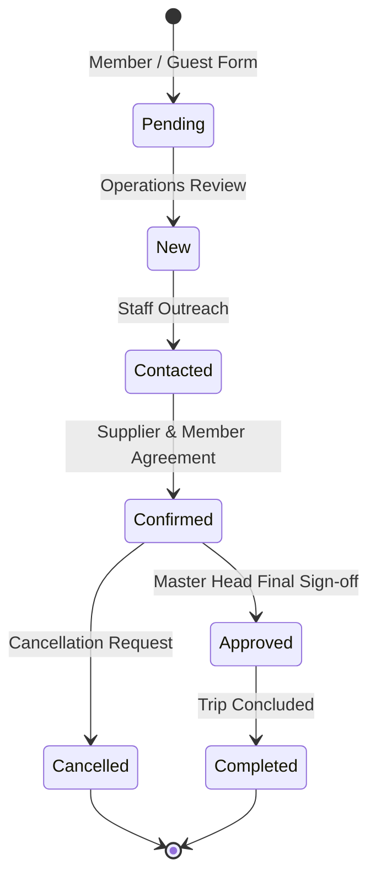

# BOOKING MANAGEMENT ENGINEERING RULES (rules/booking-management.md)

> **Status**: Active & Mandatory  
> **Domain**: Travel Bookings, Enquiries, Status Lifecycle, Night Pool Deductions

---

## 1. Booking Creation & Numbering

- **Enquiry Number Format**: Standard format is `NEX-BK-YYYY-XXXX` (e.g. `NEX-BK-2026-3171`).
- **Standard Booking Format**: Capture lead traveler full name, spouse name, children ages, check-in date, check-out date, destination, pax count, activities, and special requests.
- **Rate Limiting**: Protect public booking submission endpoints with `submissionLimiter` (25 submissions per 15 minutes per IP).

---

## 2. Booking Status Lifecycle

Allowed booking statuses:
`Pending` $\rightarrow$ `New` $\rightarrow$ `Contacted` $\rightarrow$ `Awaiting Customer Response` $\rightarrow$ `Awaiting Supplier Confirmation` $\rightarrow$ `Confirmed` $\rightarrow$ `Approved` $\rightarrow$ `Cancelled` $\rightarrow$ `Completed`.

---

## 3. Night Entitlement Deduction Safety

- **Confirmation-Only Deductions**: Room nights should only be deducted from a member's entitlement pool when a booking reaches `Confirmed`, `Approved`, or `Completed` status.
- **Cancellation Restoration**: If a confirmed booking is cancelled, restore the deducted room nights back to the member's available pool.
- **Preserve Booking History**: Never delete booking documents from MongoDB. If a customer cancels, set `status = 'Cancelled'` to preserve legal and operational audit trails.
