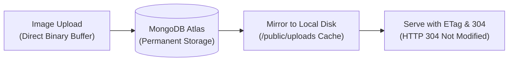

# IMAGE STORAGE & MEDIA PERSISTENCE RULES (rules/image-storage.md)

> **Status**: Active & Mandatory  
> **Critical Requirement**: Permanent Persistence on Ephemeral Railway Containers

---

## 1. Container Ephemerality & Storage Invariant

Railway cloud containers feature ephemeral disk filesystems: files written to container disks are erased upon container redeployment or restart.

**Mandatory Rule**: All uploaded destination, activity, package, and media assets must be stored permanently in MongoDB Atlas as binary buffers (`image.data` / `UploadedMedia.data`) or external persistent object storage. Never rely solely on container disk files.

---

## 2. Multi-Tier Resilient Media Pipeline

1. **Ingestion**:
   - Validate magic bytes using `detectImageSignature()` (JPEG, PNG, WebP).
   - Enforce $\le 1\text{MB}$ for direct entity images, $\le 5\text{MB}$ for generic media.
   - Store binary buffer directly into MongoDB.
   - Mirror to local disk cache.
2. **Delivery**:
   - Check request `If-None-Match` against MD5 hash of buffer $\implies$ return **HTTP 304 Not Modified** if matching (zero bytes transferred).
   - If file exists on disk $\implies$ serve via `express.static()`.
   - If missing from disk $\implies$ fallback queries MongoDB, streams bytes, and restores disk file cache.

---

## 3. Strict Image Preservation Invariants

- **Text & Price Edits**: Editing destination, activity, or package metadata (title, overview, price, duration) must strictly preserve the existing image. Never overwrite or nullify image fields during ordinary text updates.
- **Explicit Replacement Only**: An existing image must only change when an authorized administrator explicitly uploads a replacement file.
- **Failed Upload Protection**: If an image replacement fails validation, the previous image must remain completely untouched.
- **No Automatic Placeholders**: Never replace existing client-uploaded imagery with static placeholder assets automatically.
